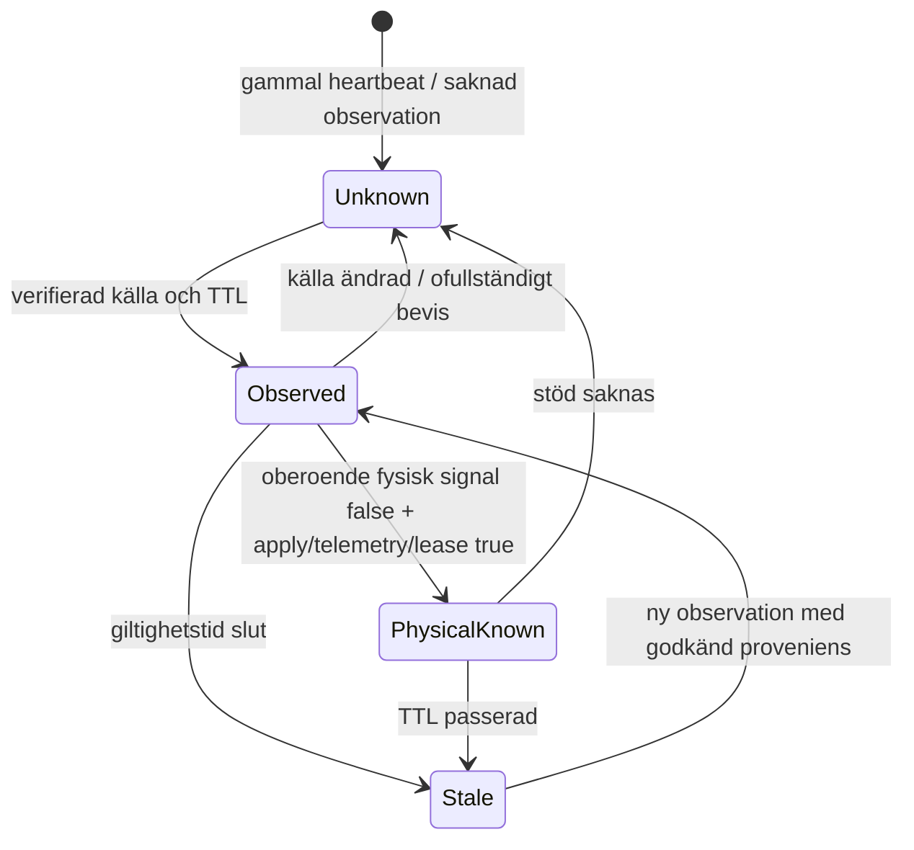

# ADR 2026-11-07: Separata kontrollhälsosignaler (S03)

**Status:** Godkänd som *offline-källkontrakt*, ej ansluten till aktiv heartbeat, supervisor eller ny styrsignal. **Implementation:** `scripts/services/control_health_contract.py`; **verifikation:** `scripts/tests/test_control_health_contract.py`, 7/7 (offline).

## Kontrakt och giltighet

`classify(heartbeat, now)` läser en **frivillig** `control_health_v1`-nyckel i ett redan existerande heartbeat-objekt; äldre `{"timestamp": "..."}` får alla sex signaler `unknown`, inte implicit `true`. Nyckeln är ett **framtida schema**; ingen skrivare producerar det ännu. Sex oberoende `{"value": boolean, "source": "...", "observed_at": timezone-aware ISO 8601}`:

| Signal | Tillåten källa i kontraktet | TTL s | Vad det **inte** betyder |
| --- | --- | ---: | --- |
| `process_alive` | `systemd` | 120 | Inte lyckat styrbeslut; heartbeat-ensam räcker inte |
| `last_decision_ok` | `dispatcher` | 120 | Inte kvitterad fysisk effekt |
| `last_apply_verified` | `register_and_power` | 75 | Utan oberoende mätproveniens ej permanent säkerhetskvitto |
| `telemetry_fresh` | `poller` | 90 | Färsk data kan ändå vara felkalibrerad |
| `broker_owned` | `lease` | 75 | Lease är inte ensam global TCP-ägare |
| `physical_state_unknown` | `independent_observer` | 75 | `false` = tillstånd **bedömt känt**, inte säkert/GO |

Tolkningsvärden: `true`/`false` (tydliga observationer), `stale` (över TTL eller för mycket framtidsdrift), `unknown` (saknas, fel källa/typ/tidszon, otillräckligt stöd). Tolerans för framtidsdrift maximalt 5 sekunder. Den **enda cross-signal-valideringen i kontraktet** gäller `physical_state_unknown=false`: den nedgraderas till `unknown` med `unsupported-physical-known-claim` om någon av `last_apply_verified`, `telemetry_fresh` eller `broker_owned` inte är färsk `true`. Utgången är alltid observerande, **aldrig** fysisk styrtillåtelse.

## Felaktiga övergångar och testkedja

Testerna avvisar: legacy heartbeat som fysisk bekräftelse, falskt besluts-/apply-kvitto utifrån liveness, gamla/framtidsdaterade prover, godtycklig källa, text `"true"`, ofullständig `physical_state_unknown=false`, förlorad brokerlease och okända framtida schemaversioner.

**Implementationsgräns:** källkontraktet är inte driftsatt och bevisar inte att någon producent verkligen kan ge oberoende `register_and_power` eller `independent_observer`. Det får inte kopplas till beslut eller automatisk Auto före testad S05/S06/S08 och separat operatörsgodkännande. Se [felmatris](failure-mode-matrix-2026-11-07.md).
