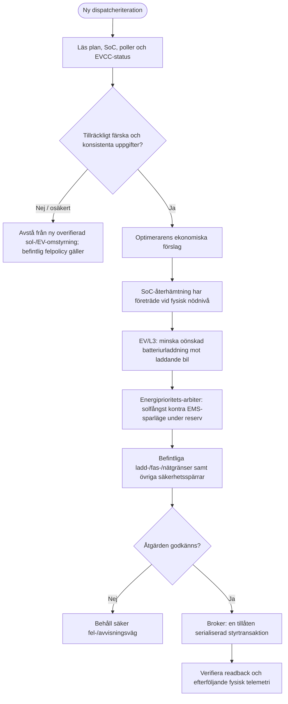
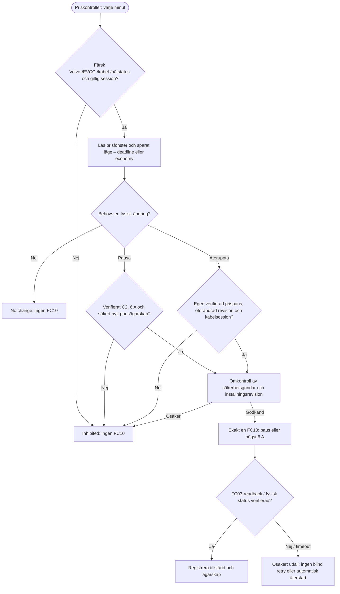
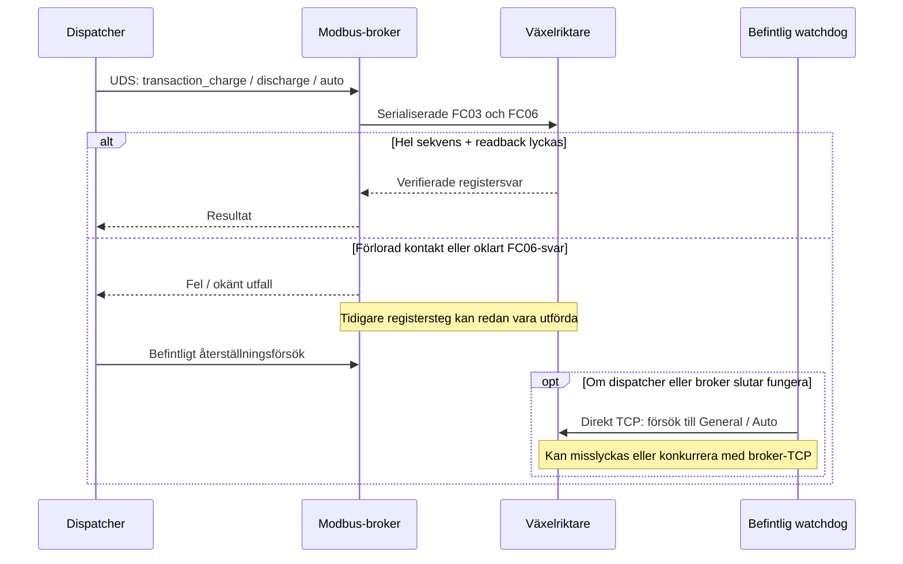

# Styrflöden – prioritet, EVCC och felvägar

**Tolkning:** Diagrammen förenklar styrbeslut för att visa **ordning och ansvar**. Den faktiska koden och de dokumenterade driftsbesluten är normerande. Diagrammen utgör varken en certifierad elsäkerhetsanalys eller en komplett formell specifikation.

## Batteriets dispatchkedja

Detta är **prioritering av styrförslag**, inte en algoritm som kan styra eller bevisa enskilda elektronflöden. Återhämtning prioriteras före prisväntan, och en pågående riktig laddning får inte ersättas av ekonomiskt sparläge. Under den mjuka **20 %-reserven** kan två separata, tidsmässigt konsekventa solöverskottsprover låta General ersätta EMS 50 W; hysteresis och urladdningsbudget hindrar snabb växling tillbaka. Ovanför reservnivån styr befintlig optimerare ekonomin. Den här arbiter-versionen är **inte** en generell ersättare för alla optimeringssteg. Se [fullständig prioritet och tröskelvärden](adr-2026-11-05-energy-priority-arbiter.md).

### Fysisk säkerhet kontra mjuk ekonomi

| Regel | Verifierbar innebörd | Begränsning |
| --- | --- | --- |
| Fysisk SoC-recovery | Särskild återhämtning vid låg SoC | Ladd-/fasskydd gäller även då |
| EV grid-first | Minska batteriets bidrag till bilens last när mätningen räcker | Separat EVCC-Ict2 kan inte visa exakt källa till varje watt |
| Solupptagning | Undvik onödig export och EMS/General-fladder under låg reserv | General kan fortfarande urladda innan nästa reglering |
| Batterisparläge | Ekonomiskt avstå från större uttag vid låg reserv | EMS-börvärde 50 W är **inte** 0 W |
| EndSOC och BMS | Fysiska skydd måste vara sista barriär | Prioritet hos native EndSOC i EMS BattCtrl är ännu **inte verifierad** |

## EVCC:s automatiska prisstyrning

**Viktiga konsekvenser:** Att trycka **Spara laddläge** i webbgränssnittet ändrar endast beständig avsikt. Webb-API:t skickar ingen FC10. En gammal prispaus får inte ärvas av en ny laddmission eller en ändrad avresetid. Smart Charging-status från Volvo måste vara entydigt avstängd för ny prisstyrning. Utan färsk sessions- och kabelkontinuitet är **ingen skrivning** det avsedda konservativa resultatet. Se [laddlägen och revisionsskydd](adr-2026-11-05-ev-web-live-mode-selection.md) och [verifierad prisaktivering](adr-2026-11-04-ev-price-empirical-live.md).

## Brokerfel och återställning

Den gamla watchdoggen saknar idag verifierad fencing och fullständig oberoende återställning för alla fel. **Ingen av pilarna vid fel är en garanterad fysisk återgång till Auto.** Se [accepterad felvägsrisk](adr-2026-11-04-broker-legacy-failure-scope.md), [transaktionernas begränsningar](adr-2026-11-04-broker-complete-transactions.md) och [kända brister](../known-issues.md).

[Systemets komponentkarta](system-overview.md) · [Aktuell driftstatus](../current-state.md).
