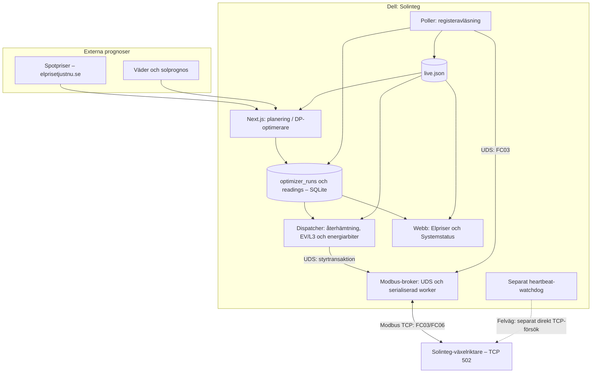
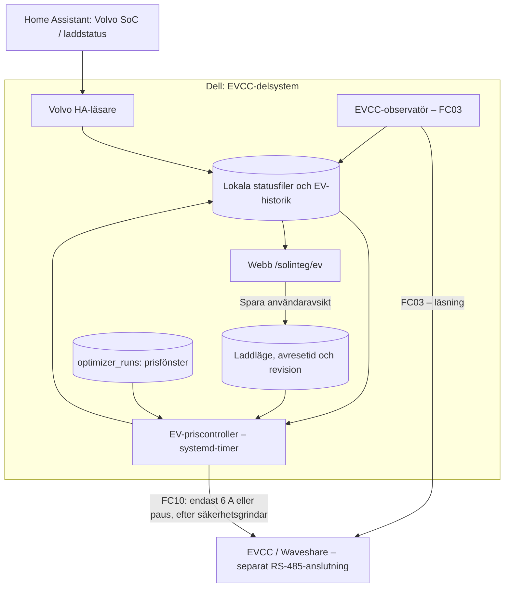

# Systemarkitektur – Solinteg på Dell

**Senast dokumenterat:** 2026-11-07. Diagrammen beskriver den [dokumenterat driftsatta normalvägen](../current-state.md), inte en ny systemdesign eller garanterad fysisk effekt. Git-versionen och den platsanpassade installerade dispatchern skiljer sig åt. Se [kända brister](../known-issues.md).

## Husbatteri: prognos, beslut och Modbus

**Viktiga gränser:** Optimeraren beräknar en plan; dispatchern avgör vad som faktiskt får begäras. Modbus-brokern är normalvägens enda TCP-ägare och serialiserar hela kommandosekvenser. **Styrtransaktionen är inte atomär i växelriktaren:** ett nätavbrott kan lämna delvis skrivna register. Den befintliga watchdoggens direkta återställningsförsök vid fel är inte en verifierad, exklusiv nödfallback. Se [brokerbeslutet](adr-2026-11-04-broker-complete-transactions.md), [känd felväg](adr-2026-11-04-broker-legacy-failure-scope.md) och [drift/rollback](../modbus-broker-transactions-release-2026-11-04.md).

## Bil: separat EVCC-styrning

**Ingen gemensam Modbus-broker för laddboxen:** EVCC:s FC03-observatör och enda tillåtna FC10-priscontroller använder den separata Waveshare-vägen och samordnas med sitt eget lås och pausägarskap. Webb-API:t lagrar *avsikt*, aldrig ett direkt FC10-kommando. Priscontrollern kan avstå från skrivning om SoC, kabelspårning, Smart Charging-status, nät-/fassituation eller ägarskap är osäkert. Faktisk uppmätt elförbrukning och uppskattad Volvo-energi är inte likvärdiga. Se [EVCC-livebeslut](adr-2026-11-04-ev-price-empirical-live.md), [webbinställningar](adr-2026-11-05-ev-web-live-mode-selection.md) och [empirisk energimodell](../ev-ac-soc-empirical-2026-11-04.md).

## Ansvars- och säkerhetsgränser

| Komponent | Får ändra | Får inte förutsättas |
| --- | --- | --- |
| Webb / API | Laddavsikt och presentationsdata | Direkt inverter-FC06 eller EVCC-FC10 |
| Optimerare | Ekonomiskt planförslag | Fysisk säkerhet eller verkställd laddning |
| Dispatcher | Godkända börvärden via broker | Absolut 20 %-BMS-golv eller verklig nollförbrukning i EMS |
| Broker | Tillåtna Modbus-transaktioner, serialiserade i normalvägen | Hårdvaruatomäritet eller garanterad fallback |
| EV-priscontroller | Verifierad EVCC-paus/återupptagning inom 6 A | Automatisk återstart efter manuellt eller oklart stopp |
| Poller/observatörer | Färska läsningar och historik | Fysisk energikällespårning eller certifierat fasöverströmsskydd |

För hur prioriterings- och prisbesluten tas, fortsätt med [Styrflöden och felhantering](control-flows.md). För tidsstämplad runtimeinventering, se [Aktuellt driftläge](../current-state.md).
