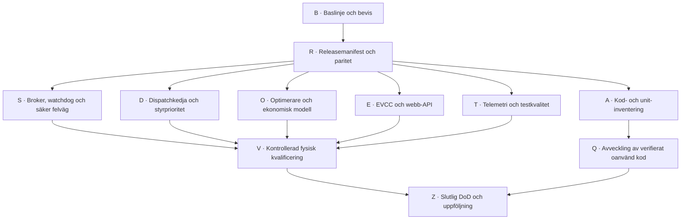

# Genomförandeplan: kodstruktur, driftsparitet, säkerhet och upprensning

**Start:** 2026-11-07 · **Status:** aktiv plan, implementering ej påbörjad inom denna plan · **Repo:** `ermhawi/solinteg-controller-oss`, permanent branch `Sundsvall` · **Mål:** trygg, testbar och underhållbar energistyrning med spårbar release och utan övergiven driftkod.

Detta är en **checklista för små, oberoende arbetspaket**, inte ett godkännande för automatisk driftsättning, fysiska Modbus-/EVCC-prov, systemd-omstarter eller radering. [Aktuell drift](../current-state.md), [kända risker](../known-issues.md), [systemkarta](../architecture/system-overview.md), [styrflöden](../architecture/control-flows.md) och [repo-/driftgräns](../repository-layout.md) ska läsas före respektive ändring.

## Arbetssätt och Definition of Done

- Bocka en punkt **enbart när dess acceptanskriterium är verifierat**. Anteckna i samma punkt eller en länkad notering: datum, commit/ändrings-ID, verifieringskommando, utfall och om ändringen endast är `source`, `tested`, `installed` eller `physically_verified`. Undvik att markera en hel fas som klar på grund av en passerad delkontroll.
- En punkt är avsedd att utgöra **ett litet, granskningsbart arbete**. Dela hellre en punkt i `a/b/c` än att samtidigt ändra flera styrkedjor; inga orelaterade refaktoreringar.
- Varje ändring kräver: dokumentationspreflight; explicit beteende- och säkerhetskontrakt; relevanta enhets-/integrationstester; `git diff --check`; uppdaterad ADR/runbook/known-issues när tillämpligt; exakt filinventering; och återställningsbeskrivning. Behåll samma tillstånd i kod och dokumentation.
- **Risknivå:** `P0` = säkerhet eller förlust av verifierad driftsparitet; `P1` = felaktig energi-/pris-/EV-reglering; `P2` = förvaltning, observabilitet och hygien. Prioritet betyder inte godkännande att röra en aktiv enhet.
- **GO/NO-GO:** all fysisk förändring kräver separat uttryckligt godkännande av exakt åtgärd, gällande SoC/fas-/nätvillkor, ägare, rollback, mätvärden, observationsfönster och säkerhetsstopp. Offline-/loopbacktester räcker inte som fysisk kvalificering.
- Ingen direkt andra TCP:502-klient när brokern är ägare; ingen automatisk EVCC-återstart efter manuellt/okänt stopp; ingen tolkning av ekonomisk 20 %-reserv som verifierat BMS-/firmwaregolv.
- **Git-hygien:** bara `origin/Sundsvall`, aldrig merge till `main`/upstream eller force-push. Publicera inga verkliga privata IP-adresser, tokens, miljöfiler, hushållsrådata eller fakturor. Hantera pågående ocommittade ändringar innan någon kodrelease; kasta aldrig bort dem för att skapa en ren arbetsyta.
- Avsluta varje delsteg med kontroll av arbetsträd, öppna arbetsträd/stashes, berörda runtime-resurser, aktiva tjänster, bevarat återställningsunderlag samt nästa blockerare. Privat driftbevis förblir utanför publika Git.

## Baslinje: verifierad kodgranskning 7 november 2026

| Område | Underlag och tolkning |
| --- | --- |
| Omfattning | Cirka **374** spårade/ospårade käll- och testfiler, cirka **79 500** kodrader; siffrorna är inventering, inte kvalitetspoäng. |
| Python | `python3 -m unittest discover -s scripts/tests -p 'test_*.py'`: **1 617 tester, godkända**. |
| TypeScript | `npm test`: **742 godkända**, **1 överhoppat**; `npm run typecheck`, `npm run build` godkända. |
| Kvalitetsvarningar | `npm run lint`: **1 unused-import-varning**. Extra `tsc --noEmit --noUnusedLocals --noUnusedParameters`: **2 unused-fynd**. |
| Nås från webbens entrypoints | **83/83** TS/TSX-produktionsmoduler nåbara enligt statisk importgraf; detta utesluter inte döda kodgrenar. |
| Python-tjänster | **38 av 79** moduler i `scripts/services` saknar statisk importväg från inventerade aktiva systemd-entrypoints. **Kandidater, inte säkert död kod**: EV-runtime, manuella verktyg, dynamiska importer och reservfunktioner måste kontrolleras. |
| Källkod kontra drift | Git-`dispatch_loop.py` **2 312 rader** mot installerad **1 960** vid kontroll. Skillnader även i broker, `lib/optimizer.ts`, `lib/plan.ts` och `lib/prices.ts`. Separat EV-runtime matchade granskade centrala EVCC-moduler. |
| Driftflaggor | Läsande kontroll visade på den installerade dispatchern `SOLINTEG_CONTROL_ARMED=1`, `DISPATCH_ENERGY_PRIORITY=1`, `SOLINTEG_MODBUS_SOURCE=broker_transaction`. Dessa är tidsbundna observationer, inte en publicerbar komplett env-dump. |
| Git-preflight | **8 modifierade och 4 ospårade befintliga kod-/test-/probe-filer**, 0 staged, 0 stashes, 0 omergade brancher, 1 worktree. De tillhör inte denna plan och får inte skrivas över/städas bort oavsiktligt. |

### Avklarad inventering (ingen kodförändring)

- [x] **B00** – Läsande arkitektur-/drift-/Git-inventering genomförd 2026-11-07. **Bevis:** granskade `systemctl`-entrypoints, SHA-/AST-skillnader och befintliga ADR:er; inga registerskrivningar.
- [x] **B01** – Testbaslinje insamlad enligt tabellen ovan 2026-11-07. **Bevis:** Python, Vitest, Next-build, TypeScript och ESLint.
- [x] **B02** – Övergiven-kod-kandidater identifierade med statisk Python-importgraf; inga filer klassificerade som säkra att ta bort.
- [x] **B03** – Länka en *sanerad* maskinläsbar snapshot till varje kommande implementation: Git-SHA, installerade filhashar, relevanta enhets-/timerstatus, whitelisted flaggnamn/värden, testsammanfattning och återställningsreferens. **Klart när:** två körningar kan diffas utan hemligheter eller fysisk I/O. **2026-11-07, `tested`:** [read-only-runbook och privat snapshot-ID](../operations/release-inventory.md), `scripts/tools/release_inventory.py`, `scripts/tests/test_release_inventory.py`; 12/12 offline-tester, två körningar tidsmässigt `equal` utan hemligheter. Privata filer `2026-11-07-{a,b,compare}.json`; rollback-markör `R08-pending` är **inte** bekräftad backup.
- [x] **B04** – Klassificera de 12 tidigare ocommittade filerna (energiprioritet, broker och hold-probe) som redan driftsatta / pågående / bara offline. **Klart när:** ägarskap, risk och bevarandeplan finns för varje fil; ingenting har tappats. **Verifierat 2026-11-07:** [per-fil-inventering med sha256/paritet, ägare, P0/P1 och bevarandeplan](preexisting-work-classification-2026-11-07.md); jämfört installerad kod med read-only `sudo -n` och aktiv systemd. Status `source` (inventering), ingen fysisk styrning; Git-preflight blockeras fortfarande av skyddade lokala filer.

## Beroenden och säkerhetsgrindar

**Kritisk väg:** `B03/B04 → R → S` innan ny felåterställning; `R → D/O/E → V` innan beteendeändring i produktion. `A` kan börja läsande parallellt men faktisk radering sker efter beroendekontroll. Några delsteg kan avslutas utan att deras fas är GO för drift.

## R · Releasemanifest och faktisk driftsparitet (P0)

- [x] **R01** – Bygg ett **endast läsande** verktyg som inventorierar aktiv systemd-unit, `ExecStart`, drop-in-lista, installerade Python-/TS-filhashar och repo-hashar för varje styrkedja. **Klart när:** utdata saknar privat env och visar `equal/different/missing/not-readable` för varje relevant modul. **2026-11-07, `tested`:** [inventeringsverktyg, resultat och tillåtna fält](../operations/release-inventory.md), `scripts/tools/release_inventory.py`; 18 modulpar (11 lika, 7 olika), 11 units, 12/12 offlinetester inklusive EV-importkedjan; avsiktligt endast sanerade `ExecStart`-entrypoints, inga argv/hemligheter.
- [x] **R02** – Lägg till whitelist för effektiva `armed`-/feature-flaggor, utan att skriva ut hemligheter eller hela `/proc/<pid>/environ`. **Klart när:** källans default och effektivt driftsvärde jämförs med tidpunkt och ursprung (unit/drop-in). **2026-11-07, `tested`:** 7 flaggor från aktiv read-only proc + unit/drop-in/environment-file med ursprung eller `process-unattributed`; källans literala default kontrolleras. [Runbook och maskerings-/origin-tester 12/12](../operations/release-inventory.md); ingen privat env publicerad. Ej driftsättningsändring.
- [x] **R03** – Upprätta en **explicit avvikelselista** för site-patchad `dispatch_loop.py`: `decide`, `main`, SoC-recovery, EV/L3, energi-arbiter, `apply_decision`, heartbeat, import-/fasgrindar. **Klart när:** varje olikhet har motiv och `keep/port/remove/prove`, och inga aktiva beteenden tappas. **2026-11-07, `source`/read-only:** [AST-inventering med 13 klassificerade avvikelser, 6 source-only och 7 ändrade](../dispatcher-source-runtime-diff-2026-11-07.md), med motivering/keep/prove/blocked port och riktade testförslag; automatisk test mot aktiv installerad fil verifierar samtliga namn, 13/13. Ingen live-ändring, semantiskt/fysiskt port-GO fortsatt blockerat.
- [x] **R04** – Gör motsvarande semantisk diff för `lib/optimizer.ts`, `lib/plan.ts`, `lib/prices.ts`, brokern och Next-servern. **Klart när:** kända driftfunktioner kan härledas till installerad filversion och test, inte bara Git-HEAD. **2026-11-07, `source`/read-only:** [7/7 klassificerade käll-/driftfiler med individuella installerade SHA-256, funktionsskillnader, hänvisade testkontrakt och keep/prove/block port](../web-and-broker-source-runtime-diff-2026-11-07.md). 79/79 riktade Vitest (prices, plan, optimizer-caps), brokerfakes i lokal Python-regression. Installationsparitet fortsatt NO-GO; ingen Next-deploy eller ny brokerroll.
- [x] **R05** – Dokumentera den separata EVCC-runtime under `/opt/solinteg/ev-shadow-runtime` som egen releasenyckel. **Klart när:** alla verkliga aktiva EVCC-entrypoints och deras importer har versions-/hashparitet eller förklarad avvikelse. **2026-11-07, `tested`/read-only:** [EV-releaseinventering](../operations/release-inventory.md), 4 systemd-entrypoints inkl. priscontroller-timer och 8 transitiva lokala Python-importer **12/12 byteidentiska** via SHA-256, source→runtime; `scripts/tools/release_inventory.py` uppdaterat med separat EV-releasenyckel och lokal-importkontrakt i `scripts/tests/test_release_inventory.py` (12/12 godkända). Externa Pythonpaket/dynamiska filer återstår i R06; ingen FC10 exekverad.
- [x] **R06** – Definiera **reproducerbar releasekandidat**: exakt filmanifest, beroenden, lagrings-/SQLite-schema, systemd-diff, verifieringsmatris och privat rollback-snapshot. **Klart när:** staging kan återskapa kandidaten utan att skriva till aktiv `/opt/solinteg`. **2026-11-07, `tested`/source-only:** [runbook och 7-lagers verifieringsmatris](../operations/private-release-and-rollback-2026-11-07.md); `scripts/tools/stage_release_candidate.py`, 5/5 offlinetester, två privata kandidater 602 committade filer med identisk stabil SHA-256 `dea73d50a679`, fem låsta/hashade beroende-filer, 8 schema-tabeller och 70 unitmallar. Read-only systemd: 7 equal, 3 different, 1 unverified. Privat 24-filers rollback-snapshot finns; `release_go=false`, ingen driftändring.
- [x] **R07** – Lägg till driftkontroll före/efter release som jämför manifest och tar ställning till avvikelse. **Klart när:** oavsiktlig driftdivergens blockerar GO och ger tydlig rapport; ingen automatisk sync/restart skapas. **2026-11-07, `tested` (ingen live-release):** [read-only `--compare-json`/grind](../operations/release-inventory.md) gav tidsmässig `equal` men `manifest_gate=blocked`, exit 5, på sju oförklarade skillnader och smutsigt Git. Ingen sync, omstart eller fysisk kontroll; fysisk release fortsatt NO-GO.
- [x] **R08** – Dokumentera rollback inklusive delvis tillämpat filpaket, DB-kompatibilitet och heartbeat-/brokerägarskap. **Klart när:** selektiv återställning kan torrköras utan levande Modbus/EVCC-skrivning. **2026-11-07, `tested`/source-only:** [selektiv rollback-runbook](../operations/private-release-and-rollback-2026-11-07.md), `scripts/tools/rollback_snapshot.py`, 4/4 tester samt faktisk privat read-only källsnapshot **24/24** och 3 simulerade före/partiellt/efter **24/24** utan live- eller fysisk skrivning. SQLite live `mode=ro` schema 8/8 matchande tabeller/kolumner/typ/PK; heartbeat/brokerägarskap = **NO-GO tills operatör verifierar**; DB-innehåll/Next-bundle/unit/drop-ins kräver separat full backup och GO.

## S · Broker, watchdog och säker felhantering (P0)

- [x] **S01** – Skriv en **felmatris** för: död dispatcher, levande men felande dispatcher, saknad/korrupt/färsk heartbeat, nekad/stale brokertelemetri, IPC-timeout, halv FC06-sekvens, nätbortfall, Wi-Fi-omstart, låskonflikt och strömavbrott. **Klart när:** varje fall har detektor, fysisk osäkerhet, tillåten handling, operatörslarm och återhämtning. **2026-11-07, `source`:** [11-falls felmatris, detektor/unknown/åtgärd/larm/återhämtning](../architecture/failure-mode-matrix-2026-11-07.md); validerad mot watchdog-, dispatcher-, brokerkälla och ADR, 5 fokuserade tester. Ingen fysisk felinjektion.
- [x] **S02** – Reproducera i rena tester att `watchdog.py` avstår när heartbeat saknas/är korrupt och att dispatchern kan fortsätta uppdatera heartbeat efter fel. **Klart när:** testerna beskriver nuvarande begränsning utan att anta att `alive` = `safe`. **2026-11-07, `tested`:** `scripts/tests/test_safety_gap_contracts.py` tre watchdogkontrakt inkl. AST-ordning (heartbeat efter fångat exceptionsblock), färsk heartbeat med `error_revert_failed` och korrupt/ingen heartbeat; 5/5 totalt, ingen live I/O. [Begränsning och risk](../architecture/failure-mode-matrix-2026-11-07.md).
- [x] **S03** – Separera framtida signaler `process_alive`, `last_decision_ok`, `last_apply_verified`, `telemetry_fresh`, `broker_owned`, `physical_state_unknown`. **Klart när:** kontrakt, TTL och felaktiga övergångar finns som testbara tillstånd; heartbeat-format är bakåtkompatibelt eller migrerat. **2026-11-07, `tested`/source-only:** [ADR med sex separata signaler, TTL, proveniens, tillstånd/övergångar](../architecture/adr-2026-11-07-control-health-contract.md); `scripts/services/control_health_contract.py` + `scripts/tests/test_control_health_contract.py`, 7/7 offline. Äldre heartbeat returnerar `unknown`; ingen ny live-signal eller styrgrind aktiverad.
- [x] **S04** – Reproducera **behörighetsfelet för `safety_auto`**: säkerhetsrollen listar operationen, men kontrollkörlägets allowlist `READS | TRANSACTIONS` saknar den; verifiera även att produktionsrollmappningen inte tilldelar `safety`. **Klart när:** nekande/avsedd åtkomst visas i fokuserade test, utan att aktivera fysisk fallback. **2026-11-07, `tested`:** `scripts/tests/test_safety_gap_contracts.py`: production-like `runtime_mode=control` nekar safety-auto **före** transport; simulerade safety-/watchdog-cgroups får inte `safety`; definierad framtida tillåtelse till skyddad supervisor är avsikt, inte ännu aktiverad åtkomst. 5/5 godkända. [Felmatris](../architecture/failure-mode-matrix-2026-11-07.md).
- [x] **S05** – Besluta om ansvar/fencing i ny ADR: normalbroker, skyddad supervisor, watchdog, root-/systemd-stop och eventuell oberoende återställning. **Klart när:** exakt en Modbus-ägare vid varje övergång eller uttrycklig `NO-GO`; ingen blind `Auto` vid okänd SoC. **2026-11-07, `source` (arkitekturbeslut):** [ADR med övergångstabell och explicit NO-GO när single-owner/SoC/EMS saknar bevis](../architecture/adr-2026-11-07-modbus-fencing.md); stöds av 5/5 fokuserade säkerhetskontraktstester och R01/R07-paritet. Inget nytt systemd-/fallbackgodkännande.
- [x] **S06** – Implementera minsta nödvändiga offlinekorrigering av roll-/operationskontrakt och säkerhetsspärrar **bakom explicit disabled-by-default-grind**. **Klart när:** behörighetstester godkänner bara definierad supervisor och nekar alla andra cgroups/roller. **2026-11-07, `tested/source`, commit `428ee63`:** [ren S06-role/preflight policy, exakt systemd-cgroup, förbjuden lågt SoC/okänd EMS, en broker-worker](../operations/supervisor-safety-gate-2026-11-07.md); `scripts/tests/test_modbus_supervisor_access.py` **8/8** och isolerad Git-indexbyggnad **13/13**, brokerrelaterad bred testkörning **242/242**. Aktiveras endast med `SOLINTEG_BROKER_SAFETY_AUTO_ENABLED=1`, och kräver redan armed+transactions. Vid 13 % SoC/trasig CT/okänd ägare sker **0 FC06**. Inget systemd- eller fysiskt GO, installerad supervisortjänst saknas och fysisk EndSOC fortfarande okänd. Äldre ocommittade broker-/hold-probe-ändringar är ostagade.
- [x] **S07** – Kör syntetiska samtidighets-/felinjiceringstester: olika FC06-felsteg, halva transaktioner, återkommande request-id, timeout och återanslutning. **Klart när:** ingen andra skrivare öppnas, ingen blind retry sker och osäkert utfall är `unknown/inhibited`. **2026-11-07, `tested/source`, commit `095243c`:** [ny strikt default-OFF-transaktionsspärr med opt-in, osäker FC06-timeout/exceptionslatch och läsbar status](../operations/broker-strict-fencing-2026-11-07.md), `scripts/tests/test_broker_strict_timeout_latch.py` **5/5** och befintlig [felinjektion](../operations/broker-fault-injection-2026-11-07.md) **3/3**. Syntetiska steg 1/3/5, köade/nya/dubblerade request-ID, timeout och reconnect ger **0 blind retry och peak_clients=1**; ny request-ID efter `unknown` nekas `Fenced` när `SOLINTEG_BROKER_STRICT_TRANSACTION_TIMEOUT_LATCH=1`. Index-isolerad replay **16/16** inklusive S06; hel regression **1 755/1 755**. **Begränsning:** spärren är processlokal, normal dispatcher-`transaction_auto` kan blockeras i strikt läge, installation är fortfarande OFF och processdöd/restart/fysisk exklusivitet kvarstår S08/V.
- [x] **S08** – Verifiera supervisor/fencing med **loopback-syntetisk Modbus**, processdöd, socketägare och `flock`; ingen fysisk TCP:502. **Klart när:** återhämtning, misslyckat återtagande och återstart är deterministiska och loggbara. **2026-11-07, `tested/source`, commit `9a9089b`:** [S08: process-SIGKILL, kernel-flock/inode, AF_UNIX-ägare, riktig FC03/FC06 enbart på ephemeral `127.0.0.1`, restart- och återtagande-NO-GO](../operations/broker-loopback-qualification-2026-11-07.md), nya `scripts/tests/test_broker_process_fencing.py` + `scripts/tests/modbus_loopback_wire.py` **3/3**, befintlig supervisor **18/18**, host-fencing **25/25**, kernel-lease **11/11**; totalt **57/57** och full Python **1 758/1 758**. Fake Auto/readback kan tillåtas en gång bara med oberoende granskad SoC/native protection, annars explicit `unknown` och 0 fysisk skrivning. **Begränsning:** nytt S06/S07 är ej installerat, processlokal latch nollställs vid omstart, verklig TCP-/BMS-/EndSOC-exklusivitet är **fortfarande NO-GO i V02–V06/S10**.
- [x] **S09** – Utred Solinteg EndSOC/BMS/firmware och separat säkerhetsgolv innan fysisk säkerhetsklassning. **Klart när:** skillnaden mellan 20 % ekonomisk reserv och hårdvaruskydd är dokumenterad; inga overifierade antaganden står i en GO-grind. **2026-11-07, `tested/source` – utredning, INTE fysisk kvalificering:** [native EndSOC/BMS/EMS-risk, leverantörsluckor och NO-GO-grind](../operations/native-endsoc-safety-gate-2026-11-07.md), `scripts/services/native_soc_safety_evidence.py` och 4/4 offlinekontraktstester. Historiskt råvärde 52503=100 har okänd tillverkarbekräftad skala och native-gränsen kan inte antas upprätthålla 20 % ekonomisk reserv i 0x0303; dokumentationsgrinden ger aldrig fysiskt GO. Exakt firmware/vendorverifiering kvarstår före V04.
- [ ] **S10** – Definiera och godkänn en bemannad, reversibel fysisk kvalificeringsplan (se V). **Klart när:** skarpa teststeg, icke-överträdbara gränser, alternativ återställning och stoppsignal är granskade; **inget test utfört** av att planen skrivs.

## D · Ren och förutsägbar batteri-dispatch (P1, säkerhetsgrind P0)

- [x] **D01** – Inventera faktisk **prioritetsordning** och alla kodvägar som kan ändra `action/power_w/solar_skip/expected_soc` i **installerad** dispatcher. **Klart när:** tabell visar källa, villkor, ordning, hård/mjuk regel, telemetrikrav, bieffekter och konflikter. **2026-11-07, `source`/read-only:** [13-stegs installerad prioritetstabell med villkor, hård/mjuk, dataägarskap och fysisk bieffekt](../dispatcher-installed-priority-2026-11-07.md), baserad på AST för installerad SHA `274d93f6bdeb`. 11 kritiska anrop verifierade i verklig sekvens (AST read-only test PASS). Ingen driftsättning, D02/D03 fortsätter.
- [x] **D02** – Frys ett körbart **beteendekontrakt** utifrån aktuell drift: återhämtning, EV grid-first, solupptagning, ekonomisk reserv, prisplan, fasskydd och manuell intervention. **Klart när:** vart och ett av exemplen har `Given/When/Then` och avsedd åtgärd. **2026-11-07, `tested/source`, ej fysisk garanti:** [åtta explicita GWT-invarianter och gräns mot installerad 13-stegsdispatcher](../operations/dispatch-behavior-contract-2026-11-07.md); `scripts/tests/test_dispatch_intent_contract.py` **8/8 PASS** med ren energipolicy, EV/L3-beregning, pris/sol/SoC, manuell EMS-state och pausägarveto. Känd observation över reserv: ren policy lämnar EV samtidigt med planerad discharge; hela dispatcher-pariteten och fysisk EV grid-first kvar D03/D05–D09.
- [ ] **D03** – Skapa en konfliktmatris för SoC under/vid/över reserv, PV-över-/underskott, EVCC C2/urkopplad, stale CT, faslaststeg, positiv/negativ spotkostnad, förlorad broker och manuell `Auto`. **Klart när:** tester avslöjar överlappande regulatorers osynliga överstyrning. **Framsteg 2026-11-07, `tested`/source-only:** [8 ren-policy Given/When/Then-scenarier](../energy-priority-conflict-matrix-2026-11-07.md), `scripts/tests/test_energy_priority_conflicts.py`: 8/8 pass efter korrigering av fem tidigare felaktiga testförväntningar, full regressionssvit 1700/1700 PASS. **Viktig hittad risk:** över ekonomisk reserv behåller ren policy planerad urladdning även när EV laddar; under reserv ger okänd/laddande EV 50 W sparurladdning (inte 0 W). **Öppen** för integrerad dispatcher, fas/CT, pris, manuellt Auto och brokerbortfall. Ingen aktiv policy ändrad.
- [x] **D04** – Definiera ett typat beslutobjekt (`action`, effekt, upphov, policyvinnare, skäl, datakvalitet, skydd/begränsning, readbackkrav). **Klart när:** samma kontrakt kan användas av beslutsloggning och tester utan att anta fysisk verkställighet. **2026-11-07, `tested/source`, EJ installerad dispatcher:** [besluts-ADR med typat kontrakt och loggfältschema](../architecture/adr-2026-11-07-dispatch-decision-contract.md), `scripts/services/dispatch_decision_contract.py`, `scripts/tests/test_dispatch_decision_contract.py` 5/5, adapter från `PriorityDecision` bevarar action/power/winner/reason och loggar `proposed_unverified`/`physical_confirmation=unknown` oavsett positivt readbackkrav. 13 felaktiga typedata/tidszon-/fysik-claims avvisas. D05:s faktiska integration i site-dispatcher och replay kvarstår, ingen källa-/driftprioritet ändrad.
- [ ] **D05** – Extrahera **en ren prioritetsresolver i taget** från `dispatch_loop.py`, med kompatibilitetsadapter och oförändrad utdata i replay. **Klart när:** golden-master/scenariomatriser ger identiska beslut innan avsiktlig beteendeändring.
- [ ] **D06** – Granska state-reset, hysteresis och `needs_apply` vid `applied`, `accepted_pending_physical_confirmation`, `skipped`, `inhibited` och misslyckad återställning. **Klart när:** intern solstate aldrig hävdar fysisk reglering utan bekräftelse.
- [ ] **D07** – Definiera en **enda slutlig konfliktupplösning** men behåll oberoende hårda SoC-/L3-/nätgränser och den befintliga fysiska skrivaren. **Klart när:** varje simulerad iteration ger ett spårbart beslut med tydlig prioritet och ingen osäker bypass.
- [ ] **D08** – Förankra alla beslut med offline-replay från tidsstämplad data samt mot installerad dispatcher. **Klart när:** mål för EMS/General-fladder, bortkastad PV, oönskad batteriurladdning och inga falska SoC-recoveries är mätbart bättre eller oförändrat; annars NO-GO.
- [ ] **D09** – Fysisk verifiering av en **separat godkänd release** enligt V, med 24–72 h uppföljning. **Klart när:** verklig SoC, batteri-W, PV, export/import, EV, faser, kommandon och rollback jämförts med förväntan.

## O · Optimerare, prognoser och kostnadsmodell (P1)

- [ ] **O01** – Fastställ exakt produktionsversion och inställningar för `optimizer.ts`, `plan.ts`, `prices.ts`, load-/PV-prognoser och `optimizer_runs`. **Klart när:** samma indata ger samma plan i isolerad replay. **Framsteg 2026-11-07, `source/installed-observed`:** [läsande 10-modulers filhash-, 5 relevanta envflagg-/schema-/färskhetsinventering](../operations/optimizer-installed-preflight-2026-11-07.md), 5/10 hashidentiska; `optimizer.ts`, `plan.ts`, `prices.ts`, `telemetry/dispatch.ts` och `constants.ts` skiljer från installerad aktiv webb. `SOLINTEG_CONTROL_ARMED` observerad ON, O04/O06 default-off-grindar UNSET, `optimizer_runs` 12 366 rader och nyaste ~0,1h gammal. **ÖPPEN:** side-by-side isolerad replay av installerad+Git-optimizer mot identiska input/konfig saknas; ingen production/deploy/SQLite-modifiering.
- [x] **O02** – Rätta **missvisande varning** i `lib/plan.ts` som hävdar `terminal-value-0` även med positivt terminalvärde. **Klart när:** kort horisont fortfarande larmar men beskriver aktiv faktisk policy; regressionstest finns. **2026-11-07, `tested`:** beräkna samma redan använda terminalvärde före horizon-logg, rapportera positivt respektive noll/negativt värde villkorligt; `lib/__tests__/plan.test.ts` hade förväntat rött regressionstest före fix, därefter 25/25 plan+caps godkända. Produktionsversion `lib/plan.ts` skiljer ännu från Git, ingen driftsättning.
- [x] **O03** – Stäm av SoC-ceiling-kommentaren i `lib/constants.ts` med befintlig `MAX_FORCED_SOC_KWH`-grind i optimeraren. **Klart när:** kommentar, parameter och test beskriver samma beteende för tvångsladdning kontra auto-sol. **2026-11-07, `tested`:** kommentaren matchar `MAX_FORCED_SOC_KWH` och särskiljer naturlig solupptagning; `lib/__tests__/optimizer-caps.test.ts` verifierade tvångsladdning under 80%-grind och auto-sol över grinden, 6/6 godkända. Endast dokumentationsändring i kod.
- [ ] **O04** – Kör replay med sommar/vinter, 23-/25-timmarsdag, prognoslucka, kort horisont, fallande/stigande pris, batterireserv och EV-laddning. **Klart när:** inga regressionsfel, ingen oavsiktlig tömning på grund av dataluckor, och avvikelsen är kvantifierad. **Framsteg 2026-11-07, `tested/source`:** [10 scenarier med säsong, 92/96/100-slotars DST, negativ/stigande/fallande spot, solprognoslucka, EV-last och kort 8-slotshorisont](../operations/optimizer-seasonal-replay-2026-11-07.md), `lib/__tests__/optimizer-seasonal-replay.test.ts` 10/10 Vitest. **BLOCKERAD på säkerhetskravet:** med identiska två första timmar gav 8-slotshorisont **15,2107 kWh lägre planerad SoC** än 96-slotar; dagens plan loggar men stoppar inte alltid en kort horisont. **Source-mitigering:** `lib/horizon-safety.ts` och `lib/plan.ts` har nu **default-off** `SOLINTEG_MIN_PLAN_HORIZON_HOURS` som blockerar *ny* planpublicering när exempelvis 2h är under uttryckliga 12h. 5 isolerade grindtester + 2 integrationstester i `lib/__tests__/plan.test.ts`, totalt 36/36 fokuserade Vitest (inklusive säsongsreplay). Ingen driftaktivering. **Kvarvarande:** tidigare publicerad SQLite-plan återkallas ej; R04-siteparitet, verkligt prognosreplay och säker dispatcher-fallback krävs före kvittens/GO.
- [ ] **O05** – Validera **faktisk nettoekonomi** mot referens utan onödiga battericykler: spot, nätavgift, skatter, verkningsgrad, slitage och verifierad återbetalningsrätt. **Klart när:** jämförelse har samma exogena PV-/last-/prisdata och visar netto kronor, cykler och osäkerhetsintervall.
- [ ] **O06** – Kontrollera att plan endast publiceras till dispatcher med giltig live-SoC, frisk tidsaxel och versionskompatibelt SQLite-schema. **Klart när:** stale/korrupt/halvskrivna planer nekas utan nya registerkommandon. **Framsteg 2026-11-07, `tested/source`, EJ installerad:** [opt-in fail-closed publication-gate](../operations/plan-publication-preflight-2026-11-07.md), `lib/plan-publication-safety.ts`, SQLite-metadata-gate i `lib/telemetry/dispatch.ts` och kompatibel integration i `lib/plan.ts`, flagga `SOLINTEG_STRICT_PLAN_PUBLICATION=1` default OFF. 9/9 ren gate, 4/4 in-memory SQL-kontrakt och 5 nya plan-integrationstester; fokuserad Vitest 39/39. Blockerar ny publicering vid missing/stale/future SoC, NaN, DST-felaktig tidsaxel, fel DP-output och saknad/inkompatibel DB. **FORTFARANDE ÖPPEN:** tidigare publicerad plan återkallas inte och schema-ack är inte atomärt med INSERT; driftsatt dispatcher-lease, siteversion och live-paritet återstår.
- [x] **O07** – Håll ännu oprövad fysisk batteri-`soft hold` separat från optimerarens logiska `hold`; hänvisa till [NO-GO-provet](../solinteg-broker-hold-probe-2026-11-05.md). **Klart när:** ingen planeringsflagga kan implicit aktivera ny hårdvarusekvens. **2026-11-07, `tested` + read-only installation:** [hold-/probe-frysning](../operations/probe-quarantine-2026-11-07.md), `scripts/tests/test_hold_isolation_contract.py` (3/3) och `lib/__tests__/plan.test.ts` (19/19): logiskt hold kräver opt-in+disarmed och går inte till fysisk freeze/force_hold; verklig freeze och källa-reserve_hold har separata default-off-flaggor. Lästa installerade flags disabled/unset, installerat site-dispatch saknar reserve_hold. Fysisk soft-hold **NO-GO**.

## E · EVCC, Volvo och webbåtkomst (P1)

- [ ] **E01** – Verifiera käll-/installationsparitet och ägarskap för EVCC-observatör, priscontroller, kabeltracker, Volvo-session och två `deadline/economy`-lägen. **Klart när:** varje fysisk FC10 kan härledas till exakt reviderad laddavsikt och installerad kod.
- [ ] **E02** – Dela `ev_price_controller.run_once` i rena **preflight → beslut → fysisk verkställighet → kvittens/status** utan att ändra den befintliga stoppsemantiken. **Klart när:** samma input ger samma 0/1 FC10 och samma ägarövergång.
- [x] **E03** – Täck fel-/race-fall: manuell paus, app-paus, kabel ur/i, ny connection epoch, timeröverlapp, ändrad inställningsrevision, Smart Charging oklart, timeout före/efter FC10 och förlorat ägarregister. **Klart när:** ingen oavsiktlig auto-resume eller dubbel FC10 kan reproduceras. **2026-11-07, `tested/source`:** [Given/When/Then-matris för alla nio riskenheter](../evcc-failure-race-matrix-2026-11-07.md), nytt `scripts/tests/test_ev_price_revision_races.py` 6/6 inkl. ändrad/korrupt settingsrevision under båda lås, manual/app-paus utan owner och osäkert FC10 med `pending` utan retry; tidigare 26 price-owner, 13 kabel, 7 Smart Charging, 12 controller, FC10 readback-/timeouttester och E04 7 manual-lock tester. **Ingen fysisk FC10**; SNABBT ur-/inkoppling mellan polls och externa transportskrivare återstår som fysisk NO-GO.
- [x] **E04** – Kontrollera separata EVCC-lås och att ingen annan tjänst samtidigt kan skriva FC10. **Klart när:** en kod- och driftinventering visar exakt tillåten skrivare samt nekad samtidighet. **2026-11-07, `tested/source` EJ installerad:** [inventering och korrigerat CLI-ägarskap](../evcc-writer-lock-gap-2026-11-07.md); `scripts/services/evcc_manual_lock.py`, minimalt omsluten `evcc_service.py`-FC10 samt 7/7 nya parallell-/owner-/symlink-tester, 2/2 AST- och 5/5 tidigare CLI-tester. Priscontroller tar ägarlås före reader-lock, och manuella CLI:n delar samma lås; manuella `owned/pending/releasing` nekas. R05 visade fyra aktiva EV-runtime-entrypoints med bara en schemalagd FC10-skrivare. **Begränsning:** källfixen är inte installerad; exceptionell `evcc_physical_qualification.py` förblir BEHÅLL/FRYS med separat fysiskt GO, externa TCP-klienter kan inte fencas med lokal flock.
- [ ] **E05** – Testa webb-API:er, GitHub OAuth2/reverse proxy, intern åtkomstgräns, Origin/forwarded-host-kontrakt, indata-/bodygränser och webbväljaren. **Klart när:** obehörig extern skrivning nekas i autentiserat E2E-test; UI-sparning utför inga direkta FC10.
- [ ] **E06** – Kalibrera empirisk laddenergi mot oberoende tillgänglig mätning och avslutade sessioner; behåll observerad/osäker kvalitet synlig. **Klart när:** 80 %-prognosens fel och nät-/soleffekt redovisas med mätosäkerhet, inte som certifierad energispårning.

## T · Telemetri, datakontrakt och övervakning (P1/P2)

- [x] **T01** – Inventera alla SQLite-/JSON-producenter och konsumenter: `readings`, `optimizer_runs`, `control_actions`, `live.json`, EV-ägarskap/status och kabelspårning. **Klart när:** scheman, tidszoner, TTL, atomiska writes, WAL/busy och korrupt data har ägare. **2026-11-07, `tested/source`:** [käll-/konsument-/tids- och persistensmatris](../operations/telemetry-contracts-2026-11-07.md), `scripts/tests/test_telemetry_contract_inventory.py` 4/4: samtliga 8 SQLite-tabeller och sex kontrollkritiska JSON-poster inventerade, Node/Python WAL+5 s busy, timestamp/Stockholm/DST, 65/90/240 s TTL, atomic rename vs fsync och korrupt/missing. Ingen databas- eller fysisk skrivning.
- [x] **T02** – Definiera separata mått för **processtillstånd, beslutsstatus, accepterad registerskrivning, readback och fysisk effekt**. **Klart när:** webb/statuspanel och larm inte likställer ett HTTP 200, `applied` eller färsk heartbeat med faktisk säker laddning. **2026-11-07, `tested/source` EJ driftsatt:** [femstegs observability-kontrakt, TTL och felmod](../operations/control-evidence-2026-11-07.md), `lib/control-evidence.ts` + read-only `app/api/control-evidence/route.ts` och panel under Dispatch-detaljer. 6/6 Vitest, TS-check/lint, fysiskt utfall ALLTID unknown, `applied` räcker aldrig som register-ACK; färsk batteri-W är observation. T03-larm/unknown kan inte automatiskt kvittera. Äkta systemd-/broker-ACK och oberoende fysisk verifiering återstår S06/S08.
- [x] **T03** – Inventera larmhål för nattlig broker-/Wi-Fi-störning, avsaknad av heartbeat, saknad brokerägare, låg SoC, fast EMS och osäker EV-paus. **Klart när:** varje kritisk feltyp har identifierbar, deduplicerad signal och ansvarig åtgärd. **2026-11-07, `tested`/source-only:** [7 deduplicerade kritiska larmkoder, proveniens, operatörsägare och åtgärder](../safety-alert-taxonomy-2026-11-07.md); `scripts/services/safety_alert_contract.py` + `scripts/tests/test_safety_alert_contract.py` 5/5. Beständig notifiering/ack/larmrouting kvarstår T04; inget nytt produktionslarm aktiverat.
- [x] **T04** – Bryt försiktigt ut läsbara delkontroller ur den drygt 1 000 rader stora `healthcheck.py`, en grupp åt gången med testmässig ekvivalens. **Klart när:** samma historiska händelse ger samma larmfingertoppar och spärrar. **2026-11-07, `tested/source`, första isolerade gruppen:** [exakt larm-ID/priority/text/cooldown-ekvivalens](../operations/healthcheck-freshness-extraction-2026-11-07.md); två legacy-kompatibla wrappers i `healthcheck.py` anropar nya `healthcheck_freshness.py` för poller/weather freshness. `scripts/tests/test_healthcheck_freshness_parity.py` **4/4** golden-fall och tidigare healthchecks **127/127**, totalt **131/131**. `run_checks`/resolve-kedjan oförändrad, ingen /opt-/systemdändring. Övriga healthchecks kvar i original för senare självständiga små refaktorer.
- [x] **T05** – Dokumentera den installerade **Wi-Fi-watchdoggens** effektiva läge, timeout, återanslutningsförsök och reboot-eskalering, utan att ändra dem. **Klart när:** runbook och rollback kan användas utan att slå ut fysisk styrning. **2026-11-07, `source` + read-only installation:** [runbook med effektivt full-läge, 1-min-timer, 5/10/16/25s timeouts, 3/6/10-felsteg, rebootvillkor 20 min/24 h, källhash och GO/NO-GO-rollback](../operations/wifi-watchdog-readonly-2026-11-07.md); inga filer, units eller drivrutiner ändrade.
- [x] **T06** – Kontrollera backup och återläsning av styrkritiska tillstånd och schema, utanför publik Git. **Klart när:** en isolerad återställningsövning kan återge en konkret incident utan verkliga styrkommandon. **2026-11-07, `tested/source`:** [privat SQLite/WAL + JSON snapshot/restore-runbook](../operations/critical-state-recovery-2026-11-07.md), `scripts/tools/critical_state_backup.py`, `scripts/tests/test_critical_state_backup.py` **6/6 PASS**. Syntetiskt `error_revert_failed` + SoC 13 % + EV-paus `pending` återskapat via isolerad backup, scratchkorruption och selektiv återläsning; original DB/JSON oförändrade, 0 Modbus/EVCC. **Begränsning:** inget nytt live-/opt-backuppaket och ingen fysisk återstart/operatörs-GO; V03–V06 återstår.

## A · Inventera oanvänd kod, historiska verktyg och systemd (P2)

- [x] **A01** – Kör repeterbar import-/anrops-/entrypoint-inventering över **både** `/opt/solinteg/app` och `/opt/solinteg/ev-shadow-runtime`, aktiva/inaktiva units/timers, shell-`ExecStart`, verktyg och dynamiska importer. **Klart när:** 38 Python-kandidater är individuellt klassificerade; statisk icke-nåbarhet ensam är inte borttagningsbevis. **2026-11-07, `tested` + read-only drifthashar:** [85-modulers JSON-inventering](../operations/python-entrypoint-inventory-2026-11-07.json), [granskning](../operations/python-reachability-2026-11-07.md), `scripts/tools/python_reachability.py` + 5/5 tester; 22 loaded units, 15 scriptroots, 43 importerbart nåbara/42 kandidatposter (baslinjens 38/79 förändrats när nya moduler och fler units inventerats). Två `/opt`-installationer verifierade med uttrycklig skrivskyddad `sudo -n /usr/bin/sha256sum`: app 25 moduler/EV 22 moduler, övriga saknas. 42/42 kandidater klassificerade även där status är `unknown`; **0 raderingsförslag**. Ingen fysisk I/O.
- [x] **A02** – För varje modul fyll i: ägare, syfte, senaste körning om verifierbar, direkta/dynamiska referenser, testberoende, möjlig fysisk effekt, backup och kategori: `live`, `manual`, `recovery-reserve`, `historical` eller `unknown`. **Klart när:** ingen fil har `unknown` och samtidigt ett raderingsförslag. **2026-11-07, `tested`/source:** [85/85 maskinläsbara poster](../operations/python-entrypoint-inventory-2026-11-07.json) med domänägare 85/85, syfte (57 docstring/28 konservativa namn), import-/dynamik-, test-/tool-/deployrefs, möjlig fysisk effekt, SHA/Git-spårbarhet, systemd aktiv/inaktiv samt `last_execution=not_verified` där detta inte kan styrkas. 43 `live`, 6 `manual`, 19 `recovery-reserve`, 6 `historical`, 11 `unknown`; **inga** unknown har `deletion_proposed=true`. [Klassificeringsgränser](../operations/python-reachability-2026-11-07.md); ingen kod/styrning raderad.
- [x] **A03** – Börja med historiska **SoC25-/temporary-/shadow-experiment** och tidigare broker-readonly-migrering; inventera motsvarande `deploy/*.service/.timer`. **Klart när:** ingen aktiv/inaktiv men avsiktligt reserverad tjänst förväxlas med skräp. **2026-11-07, `source` + read-only systemd:** [26 specifikt namngivna service-/timerkandidater klassificerade historiska/manuella/recovery-reserve](../operations/legacy-units-inventory-2026-11-07.md); `systemctl show` gav 26/26 `not-found/inactive`, men ingen har raderats. Broker-control och EV-price-timer fortsatt aktiva; full A01–A02 reachability kvarstår.
- [x] **A04** – Markera manuella offline-/hardware-prober, inklusive förberedd broker-`hold`, som **behåll/frys** tills explicit terminalbeslut, återställningsbevis och fysisk beroendekontroll finns. **Klart när:** oavslutat NO-GO-prov inte av misstag avvecklas eller driftsätts. **2026-11-07, `source`/read-only:** [manuell/hårdvaru-/offline-inventering och ägar-/frysregler](../operations/probe-quarantine-2026-11-07.md); 9 named units/timers lästa, hold-probe `not-found`, broker aktiv; ingen avveckling/körning. Samtliga listade probgrupper märkta **BEHÅLL/FRYS**; full 38-fils nåbarhetsanalys återstår A01–A03.
- [x] **A05** – Genomför riktad TS-granskning: 83/83 nåbara moduler, sök *inuti* nåbara filer efter döda grenar, inaktiva featureflaggor och dubbla modeller. **Klart när:** varje föreslagen borttagning har referensbevis och test. **2026-11-07, `tested/source`:** [AST-baserad TypeScript-granskning](../operations/ts-reachability-review-2026-11-07.md), [JSON-bevis](../operations/ts-reachability-2026-11-07.json) och 5/5 isolerade Node-tester via `scripts/tools/verify_ts_reachability.mjs`: **87/87 nåbara** från 18 Next-roots (86/86 vid A05, ytterligare källmodul `horizon-safety.ts` i O04), 0 direkta konstanta döda brancher, 0 computed dynamic imports/olösta lokala imports, **28 flaggnamn** och en avsiktlig `EvChargeMode`-dubbeldeklaration. **0 borttagningsförslag**; runtime-flaggor/semantisk dead code är inte härmed verifierade och A06/A07 förblir öppna.
- [ ] **A06** – Rensa **högst en begränsad grupp åt gången** av verifierat avvecklade filer från repo (Git-historik behålls); separat godkännande för varje berörd installerad unit eller fil utanför Git. **Klart när:** testsvit, manifest och offline-replay är oförändrade, dokumentationen anger orsak och återställning.
- [ ] **A07** – Repetera inventeringen efter varje borttagning. **Klart när:** inga nya trasiga importer, aktiva entrypoints, systemd-`ExecStart`, testhänvisningar eller dokumentationslänkar finns.

## K · Statisk analys, testkvalitet och byggbarhet (P2)

- [x] **K01** – Ta bort den oanvända importen i `app/api/ev/settings/route.ts` med ett minimalt testat diff. **Klart när:** ESLint är utan varning för berörd kod och API-beteendet identiskt. **2026-11-07, `tested`:** borttaget endast `readEvOverview` från import; `npm run lint`, strikt `tsc --noEmit --noUnusedLocals --noUnusedParameters`, `npm test` godkända. Inget exekverbart API-beteende ändrat.
- [x] **K02** – Hantera unused-`s` i `scripts/tools/replay-deferral.ts` utan att ändra analysresultat. **Klart när:** strikt `tsc --noUnusedLocals --noUnusedParameters` passerar. **2026-11-07, `tested`:** callback-argument `s` blev `_` utan resultatändring; strikt `tsc` och `npm run lint` passerade. Offlineanalysverktyget är inte installerad drift.
- [x] **K03** – Inför **gradvis** Python-lint/format-/säkerhetsskanning (t.ex. Ruff med tydligt begränsad regeluppsättning), i rapportläge först. **Klart när:** baslinjen är känd och inga oförutsedda massformateringar blockerar säkerhetsfixar. **2026-11-07, `tested`/report-only:** [Ruff 0.17.4-baserad baslinje](../python-static-quality-2026-11-07.md), 144 fynd i 53 filer (bl.a. 24 S608 och 1 B006), 218 filer föreslås formaterade; inga filer automatiskt ändrade. Valda regler, kommando och framtida gradvis CI-grind dokumenterade; rapportfynd är inte bevisade exploateringar.
- [x] **K04** – Skilj rena enhetstester, SQLite-integration, syntetisk Modbus/EVCC och **manuella fysiska** tester med namn och explicita gates. **Klart när:** vanliga CI-kommandon aldrig kan nå riktig inverter, EVCC eller privat runtime. **2026-11-07, `tested`:** [isoleringsmatris och särskilt fysisk GO](../test-boundary-and-ci-2026-11-07.md); GitHub-hostad workflow utan privat /opt, armering eller fysisk TCP; `scripts/tools/ci_safety_preflight.py` + `test_ci_safety_preflight.py` 4/4, testar avslag för alla felaktiga flaggor, nätadress och privat runtime. GitHub Actions run `42364379003` på `2b72a34`: tre jobb **success**; inget fysiskt prov.
- [x] **K05** – Lägg till riktad kodtäckning/property-/mutationstest för brokerbehörighet, fel-/watchdogmatris, prispaus, dispatchkonflikter och DP-kostnadsfunktioner. **Klart när:** muterade riskvillkor orsakar testfel; antal tester ensamt är inte acceptansmått. **2026-11-07, `tested/source`:** [sex verkliga AST-/kostnadsmutanter och oberoende kill-assertions](../operations/targeted-safety-mutation-2026-11-07.md): `scripts/tests/test_safety_mutation_contracts.py` 4/4 med in-memory mutation av broker authorization, watchdog missing heartbeat, persistent EV-pausveto och SoC-recovery; `scripts/tools/verify_optimizer_wear_mutations.mjs` 1 baslinje + 2/2 dödade DP-kostnadsmutanter i Node-VM. S07-felinjektion, E04 owner-race, D03 och seeded DP-property kompletterar. CI-webbgrind utökad för Node-mutation. Ingen aktiv kod/hårdvara muterad; mutationen täcker utvalda riskinvarianter, inte all branch coverage.
- [x] **K06** – Lägg in en **icke-driftsättande** kvalitetsgrind i CI: Python, Vitest, TypeScript, ESLint, Next-build, docs strict, schema-/kontrakttest och release-manifestvalidering. **Klart när:** röd grind hindrar releaseförberedelse men aldrig startar/stänger fysisk tjänst. **2026-11-07, `tested`:** `.github/workflows/quality.yml`, [runbook](../test-boundary-and-ci-2026-11-07.md), källa-only manifest 24 moduler/11 enheter samt 15/15 manife­sttester. GitHub Actions run `42364185610` bekräftat **failure** när `energy_priority_policy.py` saknades från git, därefter run **`42364379003` = success** i Python, Next/Vitest/TypeScript/ESLint och Zensical på `2b72a34`; token `contents:read`, ingen deploy/systemd/Modbus/EVCC. Releaseparitetsgrind R07 kvarstår NO-GO.
- [ ] **K07** – Minska kända högkomplexitetsnoder endast med golden-master: `dispatch_loop.py`, `lib/optimizer.ts`, `lib/oracle.ts`, `healthcheck.py`, `PriceChart.tsx`. **Klart när:** modulgränser och ansvar förbättrats mätbart utan orelaterade beteendeändringar.

## V · Fysisk kvalificering och kontrollerad release (P0-gate)

**Den här fasen är helt NO-GO tills specifik release har godkänts.** En lyckad testsamling eller samma Git-commit som någon gång tidigare var driftsatt räcker inte.

- [x] **V01** – Upprätta testmatris och risk-/rollbackägare per fysisk release (broker/failsafe, dispatch, EV, optimerare hålls åtskilda). **Klart när:** exakt godkännande, före-värden och stopvillkor dokumenterats. **2026-11-07, `tested/source`, endast PLAN:** [GO/NO-GO-runbook](../operations/physical-qualification-plan-2026-11-07.md), [maskinläsbar matris](../operations/physical-qualification-matrix-2026-11-07.json) för fyra separata releasegrupper med operatörs-/rollbackroller, identitets-/föremät-/backupfält och konkreta stopp/rollback. 3/3 isolerade kontraktstester, explicit `PREPARED-NO-GO` och `approval_granted=false`; fysiskt godkännande, namngivna ansvariga och faktiska förmätningar återstår till S10/V02. Ingen fysisk provning.
- [ ] **V02** – Gör **read-only preflight**: fysisk SoC, växelriktarläge, aktuell batteri-W, CT-/nät-/L3-kvalitet, EVCC-kabel/Smart Charging, väder/PV, brokerägarprocess, senaste lyckade transaktion och schemalagda timers. **Klart när:** alla villkor uppfyllda; okänt ⇒ NO-GO.
- [ ] **V03** – Säkerställ signerad/hashad och verifierad återgång till **just installerad** kod och privata inställningar; ingen ersättning av site-dispatcher med Git-filen som helhet. **Klart när:** rollback kan utföras utan att förlora en aktiv säkerhetsgrind.
- [ ] **V04** – Utför enbart **särskilt godkänd** smal release och observera systemd, poller, plan, FC03/FC06-/FC10-kvittenser, SoC, batteri-W, PV, import/export, faser och larm. **Klart när:** ingen oönskad strömväg eller oklar kontrollägare; fel ⇒ följ rollback.
- [ ] **V05** – Följ upp 24–72 h med jämförelse mot baseline och kontrafaktisk energikostnad. **Klart när:** driftstabilitet, ekonomiskt netto, reserver, fasgränser och EV-sessioner har verifierad eller uttryckligen okänd slutsats.
- [ ] **V06** – Dokumentera resultat som `installed` respektive `physically_verified` samt avvisade hypoteser. **Klart när:** ADR, known-issues, runtime-manifest, återställningsinstruktioner och denna checklista överensstämmer.

## Z · Slutkontroll och fortlöpande förbättring

- [ ] **Z01** – Kör hela regressionen mot den **verkliga releasekandidaten** och CI; beskriv kvarvarande risk och undantag. **Klart när:** rött endast för dokumenterade och accepterade icke-säkerhetsblockerare; säkerhetskritiska fel ⇒ NO-GO.
- [ ] **Z02** – Stäm av `Git source ↔ installed files ↔ effective flags ↔ runtime observations` med samma manifest-ID. **Klart när:** inga oförklarade skillnader i kritisk styrkod.
- [ ] **Z03** – Utför Git-hygien: endast uppgiftsrelaterade, sanerade commits till `origin/Sundsvall`; inga orelaterade ändringar bortkastade och inga extra worktrees/stashes. **Klart när:** projektets `git_hygiene.py --mode done` passerar, eller blockerare redovisas.
- [x] **Z04** – Städa endast **bekräftat ägda och inaktiva** tillfälliga processer, testartefakter och systemd-resurser; bevara krypterade återställningsbevis och terminala statusfiler. **Klart när:** ingen aktiv styr- eller återställningsförmåga påverkats. **2026-11-07, `tested`/read-only runtime:** [24 explicit ägarkontrollerade sessionlogs-/mellanrapporter städade efter 0 identifierade aktiva testprocesser](../operations/iteration-cleanup-2026-11-07.md), inga osäkra kandidater raderade. Privata beständiga återställningspaket, Git-diff/worktree/stash och terminala statusfiler bevarade. Läsande `systemctl show` efteråt: aktiv broker, dispatcher, EV-price-timer och Wi-Fi-timer oförändrade; `hold-probe` not-found/inactive. **Inga** systemd-stoppar/omstarter eller fysiska skrivningar.
- [ ] **Z05** – Genomför ny läsande kod-/driftgranskning och uppdatera riskregistret. **Klart när:** varje P0/P1-fynd antingen är verifierat åtgärdat eller uttryckligen accepterat med ansvar, kompensatorisk kontroll och återbesöksvillkor.

## Uppföljningslogg

Använd korta noteringar efter varje avslutat steg. Detaljerade privata mätningar lagras **utanför publika Git**.

| Datum | ID | Evidens/commit | Status: source / tested / installed / physically_verified | Kvarvarande risk och nästa ID |
| --- | --- | --- | --- | --- |
| 2026-11-07 | B00–B02 | Kodgranskning av `Sundsvall` och läsande runtime, testbaslinje enligt ovan | Audit completed, **ej** fix/release | Bevara tidigare arbete |
| 2026-11-07 | B03, B04, R01, R02, R05, R07 | `d7c3869`, `scripts/tools/release_inventory.py`, [runbook](../operations/release-inventory.md), [12-fils bevarandeplan](preexisting-work-classification-2026-11-07.md); 12/12 isolerade tester, read-only paritet | `tested` (B04 `source`), **inte release** | 7 installerade avvikelser; R03–R04, R06, R08 |
| 2026-11-07 | O02, O03, K01, K02 | `38f027f`; rött test före O02-fix; 25/25 riktade Vitest-tester; strict TypeScript, ESLint och full webbsuite | `tested`, källkod, **ej installerad** | O01/O04/O05/EV-kvalificering återstår |
| 2026-11-07 | S01–S05 | `ee2b281`; [felmatris](../architecture/failure-mode-matrix-2026-11-07.md), [health-ADR](../architecture/adr-2026-11-07-control-health-contract.md), [fencing-ADR](../architecture/adr-2026-11-07-modbus-fencing.md); 5+7 isolerade tester | `tested`/`source` (NO-GO för fysisk fallback) | S06–S09 och fysisk V kvalificering |
| 2026-11-07 | Full regression | 1 641/1 641 Python-enhetstester, 743 Vitest passerade/1 hoppat över, typecheck, ESLint, Next-build, Zensical strict och `git diff --check` godkända | `tested`, endast utvecklingskällkod | R07 manifestet är BLOCKED på 7 repo-/installationsavvikelser |

| 2026-11-07 | O07, A04, K03 | [Hårdvaruprober BEHÅLL/FRYS](../operations/probe-quarantine-2026-11-07.md), 3/3 hold-isolation, 19/19 Vitest, [Ruff-baslinje 144 fynd](../python-static-quality-2026-11-07.md); origin commits `8698a0d`, `ac1fa66` | `tested` / `source`; inga installerade ändringar | R06, fysisk hold NO-GO |
| 2026-11-07 | K04, K06 | [CI-grind utan deploy](../test-boundary-and-ci-2026-11-07.md); Github-run `42364379003` grön (3/3 jobb) efter källkomplettering `2b72a34`; 4/4 fail-closed och 15/15 manifesttester | `tested` i origin/Sundsvall, ingen driftpåverkan | Git-hygien lokalt blockerad av skyddade preexisting diffs |
| 2026-11-07 | R03, R04, D01 | [13 dispatcher-avvikelser](../dispatcher-source-runtime-diff-2026-11-07.md), [7 optimizer-/broker-/webavvikelser](../web-and-broker-source-runtime-diff-2026-11-07.md), [installerad priokö](../dispatcher-installed-priority-2026-11-07.md); AST-tests 13/13 och 11/11, 79 riktade Vitest | `source`/read-only, ingen release | Samtliga riskfyllda porteringar NO-GO tills R06/R08/V |
| 2026-11-07 | T05, A03, T03 | [Wi-Fi full/reboot-drift och rollback](../operations/wifi-watchdog-readonly-2026-11-07.md), [26 historiska units](../operations/legacy-units-inventory-2026-11-07.md), [7 larmtyper](../safety-alert-taxonomy-2026-11-07.md); larmtester 5/5, docs strict | `tested/source`, läsande driftstatus | Nya notifieringar/ack saknas T04 |
| 2026-11-07 | E04 | [Gemensamt manual-/pris-/observerlås](../evcc-writer-lock-gap-2026-11-07.md), 7/7 nya manuella låstest + 2/2 AST och 5/5 befintliga CLI-tester; read-only verifierat att båda aktiva EV-units använder samma reader-lock | `tested/source`, EJ installerad | Exceptionell fysisk probe och externa TCP-skrivare fortfarande NO-GO |

| 2026-11-07 | R06, R08 | [602-fils privat staging, 24-modulers backup, 3/3 selektiva scratch-rollback och 8/8 live SQLite-tabeller](../operations/private-release-and-rollback-2026-11-07.md); verktyg och 5+4+5 tester; commits `0a432b0`, `e5ff341` | `tested` source-only, privat återställningsbevis, **ej** fysisk eller installerad release | 3 avvikande systemd-units, 1 okänd; DB-innehåll/Next/systemd inte backade |

| 2026-11-07 | S07 delvis, S09, V01 | `e1e9814` synthetic 5 FC06-step failures/timeout/reconnect (3/3), S07 öppen p.g.a. saknad durable timeout-latch; `452504c` EndSOC dokumentations-NO-GO (4/4) samt 4 separata fysiska testplaner (3/3), **ej fysiska prov** | `tested/source` | S08/leverantörsbevis och separat användar-GO |
| 2026-11-07 | D03 delvis, E04, T01 | `698edd0` korrigerade 5 falska energipolicyförväntningar, 8/8; `c870e60` manual FC10 tar samma två lås som priscontroller (7+2+5 tester); `4db51ca` alla 8 SQLite/6 styrkritiska JSON-kontrakt (4/4) | `tested/source` EJ installerad | D03 L3/EV över 20 % reserv fortsatt osäkert; externa EVCC-klienter ej fenced |
| 2026-11-07 | T06, T02, K03 litet tillägg | `f1d148c` SQLite+JSON scratch backup/replay (6/6); `19c5676` läsande femnivå-API/panel utan falsk fysisk säkerhetskvittens (6/6 Vitest); `a1cbd78` borttaget mutabelt testdefault | `tested/source`, ingen /opt/driftändring | Verklig systemd/FC06-readback, live-backup och oberoende fysisk effekt ej verifierade |
| 2026-11-07 | A01, A02, A05 | `fa12c02` 83 Pythonmoduler, 41 från systemd ej nåbara med enskild klassificering och read-only två-runtimes-hash (5/5); `8603d9b` 86/86 TS-produktionsmoduler nåbara, 27 envflaggor + 1 avsiktlig typkollision (5/5 Node) | `tested/source`, **0 kodborttagningar** | A06/A07 blockerade av saknade bevis för säker borttagning |
| 2026-11-07 | K05, E03, D04, Z04 | `5e14175` fyra Python-AST-mutanter + två dödade DP-VM-mutanter; `fa93c4f` sex settings-/FC10-racetester; `44de165` typat, loggbart och alltid `physical_unknown` beslut (5/5); Z04 24 ägda temporära testfiler städade, inga tjänster påverkade | `tested/source`, enbart isolerade tester och Git | D02/D05–D09 samt V för live- och fysisk kvalificering |
| 2026-11-07 | S08 loopback/lease/processfencing | `9a9089b` [SIGKILL, 0440-kernellease, UDS-inode, localhost FC03/FC06 utan fysisk :502](../operations/broker-loopback-qualification-2026-11-07.md): 3 nya + 18 supervisor + 25 host + 11 lease = **57/57**, hela Python **1758/1758** | `tested/source` ENDAST, ingen installerad supervisor | Äkta process/SoC/EndSOC/BMS och extern TCP kräver fortsatt V/S10-GO |
| 2026-11-07 | S07 strikt default-OFF transaktionsfencing | `095243c` [felmatris och opt-in timeout-latch](../operations/broker-strict-fencing-2026-11-07.md) 5/5 + äldre 3/3 fake, isolerad staged index 16/16 och full Python 1755/1755 | `tested/source`, **ej installerad** | Latch processlokal, kräver S08:s reset-/lease-/socket-fencing och V för live-GO |
| 2026-11-07 | S06 default-off supervisorroll | `428ee63` [privilegierad cgroup-/SoC-/mode-grind](../operations/supervisor-safety-gate-2026-11-07.md) och 8/8 offline fake-tester + 13/13 från isolerad Git-indexbuild; full brokerfokuserad regression 242/242 | `tested/source`, EJ installerad | S07/S08 kräver timeout-latch, loopback ownership och särskilt V-GO |
| 2026-11-07 | Full regression på källträdet | **1 730/1 730** Python, **749/749** körda Vitest (1 skipped), Node A05 5/5 och K05 3/3, TypeScript/strikt TSC/ESLint/Next-build samt Zensical strict och Git diff-check PASS | Source/CI-grind; **ej fysisk releaseparitet** | Z01/Z02 och aktiv produktion fortsatt NO-GO med 7 historiska site-avvikelser |

**Aktuell uppföljning 2026-11-07:** **Totalt 76 | Klara 49 | Återstår 27 | Blockerade 13 (delmängd av återstående)**. De 14 övriga öppna punkterna kan fortsätta itereras med offlinekod, analys och tester; produktions- eller hårdvaruåtgärder är inte implicit godkända. Näst högsta prioritet: D03 och D05–D09 (site-dispatch och konflikter), O01/O04–O06 (replay/ekonomimodell), E01–E02/E05–E06 (EVCC), K07 samt Z01/Z02. Se det numrerade blockeringsregistret nedan.

### Verifierade blockerare (13 öppna uppgifter)

Blockerad är ett separat tillstånd för en **öppen** `[ ]`-punkt. Detta register räknas om vid varje session; ingen punkt är avbockad på grund av blockeringsnotering. De övriga **14** öppna punkterna kan fortfarande få säkra source-/offlineiterationer.

| ID | Varför hela acceptanskriteriet är blockerat | Förutsättning för att fortsätta |
| --- | --- | --- |
| **O04** | Kort prognoshorisont sänker planerad SoC med 15,2107 kWh jämfört med längre horisont under identiska två första timmar i syntetiskt replay | Testad kort-horisontspärr och giltig DST-/planpubliceringsintegration med explicit käll-/driftsparitet; ingen live-ändring utan operatörens GO |
| **S10** | Bemannat och uttryckligen godkänt fysiskt testfönster saknas | Operatör namnger ansvar/rollback, färsk SoC och explicit GO för ett konkret prov |
| **E06** | Otillräckligt kalibrerat mätunderlag för en färdig EV-laddsession till 80 %, och osäker nät/sol-attribution | Reproducerbar session från HA/EVCC med verifierat faktisk energi, kabel-epoch och SoC |
| **A06** | 41 statiskt ej nåbara Pythonkandidater är ännu manual-/recovery-/historik-/unknown, utan säkert bevis om oanvändning | Avsluta indirekt/import-/cron-/restorekontroll och välj högst en explicit verifierat borttagbar grupp; inga installerade filer utan separat GO |
| **A07** | Kräver en **genomförd säker A06-borttagning** för att testa eftereffekt | A06 är bevisad och committad, därefter ny full inventering |
| **V02** | Fysiskt preflight med samtliga färska SoC/BMS/CT/EVCC/firmware- och ägarbevis har inte uppfyllts | Operatörsgodkända läsningar och inga unknown-fält; annars NO-GO |
| **V03** | Källsnapshot/R08 är inte en komplett privat DB-/systemd-/Next-/konfig-backup med verifierad restaurering | Fullständigt privat, integritetsskyddat och återläst rollbackpaket för exakt installerad sitevariant |
| **V04** | Separat uttryckligt GO till **fysisk** Modbus-/EVCC-/systemd-kvalificering saknas | Bemannat releasefönster, uppfyllt V02/V03, stoppsignal och konkret selektiv rollback |
| **V05** | Kräver en **godkänd V04-installation** och 24–72 h ny faktisk drift | Tidsserie/pris/nettokostnad efter separat kvalificerad release |
| **V06** | Kräver V04/V05 samt oberoende, fysiskt verifierad driftstatus | Uppdaterat installerat manifest och godkända observationer, inga antagna BMS-värden |
| **Z02** | Fortsatt oklassad/icke-portad käll-/driftdivergens i sju moduler och okända live build-/drop-in-detaljer | R03/R04:s utpekade porteringar testas och separat kvalificerad site-paritet bekräftas |
| **Z03** | `git_hygiene.py --mode done` blockerad av 14 skyddade äldre lokala ändringar i arbetskatalogen | Klassificerat och ägarstyrt införande av äldre ändringar; inga `git reset/clean` eller städning utan tillstånd |
| **Z05** | P0/P1-fynd kan inte självaccepteras som låg risk och vissa fysiska skydd är fortfarande okända | Namngiven operatör/ansvarig accepterar kompensatorisk kontroll, återbesöksvillkor och livscykel för varje öppet fynd |
 **P0:** befintlig broker-/dispatch-diff och äldre watchdog får inte driftsättas över varandra; S06–S08 enbart offline efter bevarad källbaslinje. Ändra aldrig aktiv /opt-kod, systemd, Modbus eller EVCC utan ett separat explicit GO.
